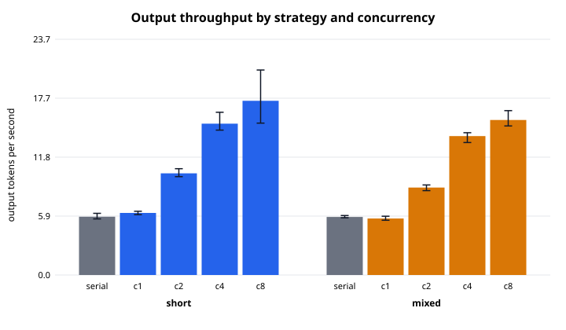
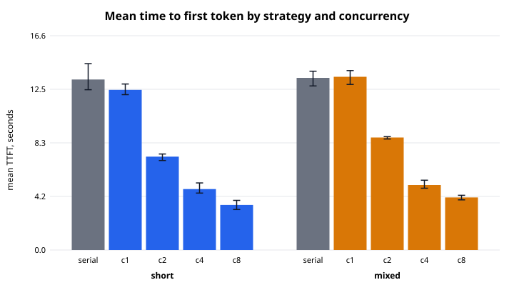
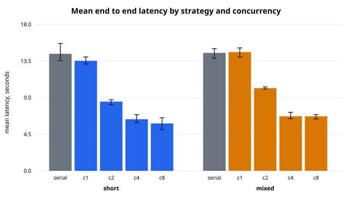

# MiniServe Results

What was measured, what it shows, and what it does not show.
Every number in this document is recomputed from a saved run
record under `benchmarks/results/`; the charts are generated
from the same files by `benchmarks/make_results_charts.py`.
Simulation results are not mixed into any table here: the
simulation pipeline has its own record in `docs/experiments.md`
and its logical seconds are not real times.

## Measurement boundary, stated once for every table

- Model: `HuggingFaceTB/SmolLM2-135M` at revision
  `93efa2f097d58c2a74874c7e644dbc9b0cee75a2`, greedy decoding,
  float32, eager attention, tokenizer from the same revision.
- Hardware: CPU only, AMD EPYC 9D25, no GPU present, PyTorch
  reports CUDA unavailable. The machine is shared, so wall clock
  values carry run to run noise that the repeat ranges show.
- Software: Python 3.12.3, torch 2.9.1+cpu, transformers 4.57.6.
- Protocol: `docs/benchmark_protocol.md`. Fixed length mode
  (executor EOS id set to -1, so every request generates exactly
  8 tokens and the work is identical across strategies by
  construction), closed batch arrival (all requests admitted
  just before the timed window), model loading and 2 warmup
  requests per strategy excluded from every window. The window
  is the wall clock around `Engine.run_until_complete()`; per
  request times are the request timestamps on `time.monotonic()`.
- Strategies: serial is `SerialScheduler` driving the single
  request executor; continuous is the default scheduler driving
  the batched executor, with concurrency meaning its
  `max_batch_size`. Prefill is one serial forward per request in
  both strategies, so a result is a strategy result (scheduler
  plus its executor), never a pure scheduler result.
- Sample: 20 requests per run, 3 repeats per configuration,
  strategy and concurrency order rotated between repeats. Each
  continuous point therefore rests on 60 finished requests,
  below the plan target of about 100 per point, so every figure
  here is exploratory. Means below are means across the 3
  repeats of the per run mean; brackets are the repeat range
  (minimum to maximum of the per run means), not a confidence
  interval. Failed and cancelled counts were 0 in every main
  experiment run, and every continuous run's token sequences
  matched its paired serial run token for token.

## Main experiment: concurrency and workload

Run id `real-main-seed1234`, produced by
`benchmarks/main_benchmark.py`. Raw per request records and the
summary live in `benchmarks/results/real-main-seed1234/`.

Workloads: short cycles the 10 protocol prompts (lengths 5 to
9, 134 prompt tokens per run); mixed alternates those with long
prompts of 20 to 24 tokens (282 prompt tokens per run). Both use
an output limit of 8 tokens per request, 160 output tokens per
run.

### Short workload

| Strategy | Concurrency | Wall s | Output tok/s | Mean TTFT s | Mean latency s | Mean TPOT s |
| --- | --- | --- | --- | --- | --- | --- |
| serial | 1 | 27.39 [25.83, 28.40] | 5.85 | 13.2452 | 14.3988 | 0.1648 |
| continuous | 1 | 25.70 [25.01, 26.41] | 6.23 | 12.4427 | 13.5387 | 0.1566 |
| continuous | 2 | 15.69 [14.99, 16.20] | 10.21 | 7.2517 | 8.5152 | 0.1805 |
| continuous | 4 | 10.56 [9.80, 11.00] | 15.19 | 4.7351 | 6.3491 | 0.2306 |
| continuous | 8 | 9.30 [7.78, 10.49] | 17.48 | 3.5028 | 5.8303 | 0.3325 |

### Mixed workload

| Strategy | Concurrency | Wall s | Output tok/s | Mean TTFT s | Mean latency s | Mean TPOT s |
| --- | --- | --- | --- | --- | --- | --- |
| serial | 1 | 27.46 [26.80, 27.88] | 5.83 | 13.3742 | 14.5063 | 0.1617 |
| continuous | 1 | 28.24 [27.11, 29.09] | 5.67 | 13.4573 | 14.6121 | 0.1650 |
| continuous | 2 | 18.23 [17.71, 18.90] | 8.78 | 8.7397 | 10.1726 | 0.2047 |
| continuous | 4 | 11.49 [11.20, 12.03] | 13.95 | 5.0521 | 6.7148 | 0.2375 |
| continuous | 8 | 10.30 [9.70, 10.69] | 15.56 | 4.0870 | 6.7141 | 0.3753 |

Reading the two tables together:

- Continuous at concurrency 1 is the fairness self check: on
  both workloads it lands within noise of serial (6.23 against
  5.85 tok/s on short, 5.67 against 5.83 on mixed), which is
  what two strategies doing the same work one request at a time
  should look like. The comparison only becomes interesting
  above concurrency 1.
- Throughput rises with concurrency on both workloads, to
  about 3.0 times serial on short (17.48 against 5.85 tok/s)
  and about 2.7 times on mixed (15.56 against 5.83). Mean TTFT
  and mean latency fall at the same time, because requests stop
  waiting for every earlier request to finish before their
  prefill can run.
- The cost arrives in TPOT: the interval between a request's
  own tokens roughly doubles from serial to concurrency 8
  (0.1648 to 0.3325 on short, 0.1617 to 0.3753 on mixed),
  because one batched forward on this CPU costs more than one
  single forward. Batching here buys waiting time and total
  throughput with per token time; it does not make any single
  token cheaper.
- Latency saturates earlier on mixed: concurrency 4 and 8 have
  the same mean latency (6.7148 and 6.7141) while TPOT keeps
  rising, so on that workload the extra concurrency past 4 buys
  throughput and TTFT only. On short, latency still improves
  slightly from 4 to 8 (6.3491 to 5.8303).
- No run is hidden: these are all 30 runs of the experiment,
  each with its range shown, and the slowest single wall time
  (29.09 s, mixed continuous concurrency 1) sits in the same
  table as the fastest.

### Charts

Each chart is generated from
`benchmarks/results/real-main-seed1234/summary.json` by running
`python benchmarks/make_results_charts.py`. Bars are means
across the 3 repeats; whiskers are the repeat range (minimum to
maximum), not a confidence interval. Device, model, sample, and
measurement boundary are the ones stated at the top of this
document for every chart.

Output throughput: the gain from batching decode is visible on
both workloads and grows with concurrency, with the mixed
workload (longer prompts, more padding) staying below short at
every concurrency.

Mean TTFT: most of the TTFT improvement is waiting time
removed, not faster prefill; prefill itself is still one serial
forward per request in both strategies.

Mean latency: falls with concurrency on short and saturates at
concurrency 4 on mixed, matching the tables above. The TPOT
cost that accompanies these gains is in the tables; there is no
fourth chart because the plan caps the main figures at three,
not because the cost is omitted.

## Mechanism experiment: token budget

Run id `real-budget-seed1234`, produced by
`benchmarks/budget_benchmark.py`: the mixed workload,
continuous at concurrency 4, only the per step token budget
varies (32, 64, 8192). All three tiers accepted exactly the same
request set (the smallest tier, 32, still admits the longest
prompt of 24), and all token sequences matched the reference.

| Budget | Engine steps | Wall s | Mean TTFT s | Mean latency s | Mean TPOT s |
| --- | --- | --- | --- | --- | --- |
| 32 | 42.0 | 13.02 [11.90, 14.70] | 6.1510 | 8.1303 | 0.2828 |
| 64 | 40.0 | 11.44 [10.81, 12.49] | 5.2530 | 6.9560 | 0.2433 |
| 8192 | 40.0 | 12.50 [11.82, 13.47] | 5.4543 | 7.3240 | 0.2671 |

The wall ranges overlap, so no tier is claimed faster overall.
What the step counts show is the mechanism: the budget binds
only when the work a step wants to pick exceeds it. At
concurrency 4 the batch size cap binds first (at most 4 rows,
decode costing 1 token each), and only a long prefill of 20 to
24 tokens can push a step over a budget of 32, which is why
budget 32 costs exactly 2 extra steps and budgets 64 and 8192
produce identical step counts. The one visible per request
effect is a deferred prefill: the first long request waited
1.4155 s in the queue in one budget 32 repeat, against 0.12 to
0.19 s in the other eight runs, because its prefill did not fit
the step in which it first became eligible. A workload with
longer prompts or a larger batch size would make the budget
bind more often; that is a prediction from the step accounting,
not a measured result.

## Bottleneck analysis

Record: `benchmarks/bottleneck_output.json`, produced by
`benchmarks/bottleneck_analysis.py`, which times the three
parts of one decode step separately on the locked model
(medians of 7 trials) and recomputes ratios from the stored
summaries above.

- The batched forward dominates the decode step at every
  measured batch size: across repeated segmented runs its
  medians fall between about 175 and 210 ms, against pack
  medians of about 0.8 to 6.4 ms and split medians of about
  1.2 to 12.0 ms across batch sizes 1 to 8. Pack and split
  together are about 1 to 3 percent of a step at batch sizes 1
  to 4 and about 6 to 8 percent at batch size 8. They copy
  every layer on every step, so their share grows with batch
  size and cached length; at the cache lengths measured here
  (at most 24 tokens) they are a real but secondary cost, not
  the bottleneck.
- Prefill is the largest structural cost the runtime controls:
  it is one serial forward per request in both strategies
  (medians typically about 0.18 to 0.36 s per request in the
  segmented runs, occasionally higher under shared CPU
  contention), so a 20 request run pays
  20 prefill forwards before decode batching can help at all,
  and a long prompt's prefill occupies its step while decode
  rows wait. This, not cache packing, is where a next
  optimization would have to aim, and batched or chunked
  prefill is outside this project's scope by design.
- Padding waste is workload shaped. Short prompts of near
  equal length waste 0 to 8 percent of packed slots at batch
  sizes 1 to 4 (27.8 percent at batch size 8, where lengths 5
  to 9 meet). The mixed workload wastes about 37 to 39 percent
  of packed slots at every batch size, because short rows are
  packed against a longest row about four times their length.
  Padding costs allocation and attention slots, never
  correctness: padded positions are masked out and are never
  counted as valid length.
- One micro optimization was tried and rejected on evidence.
  Pack was rewritten to a single zero filled allocation per
  layer with one copy per row, replacing the per row padding
  plus two stage concatenation; the packed values were verified
  identical. Segmented medians after the change were within run
  to run noise of the before medians and slightly higher in
  most configurations, so the change was reverted and the
  shipped pack code is the code that produced the main
  experiment. The before and after medians are saved in
  `benchmarks/bottleneck_pack_attempt.json`. This is recorded
  as a tried and rejected change, not as a speedup.

## Pilot

Run id `real-pilot-seed1234` (20 requests per strategy,
continuous batch size 4, single repeat): serial 27.4936 s wall
and 5.82 output tok/s, continuous 13.9019 s and 11.51 tok/s,
with the workload check passing (same finished count, prompt
tokens, output tokens, and token for token identical
sequences). The pilot's job was to expose timing, EOS, queue,
and configuration errors before the main experiment; it found
none, and its single repeat numbers are superseded by the main
experiment above rather than quoted as a result.

## Limits of these results

- One small model, one CPU only shared machine, two workloads,
  one output length, greedy decoding. Nothing here transfers
  quantitatively to a GPU, a larger model, longer contexts, or
  a different arrival pattern; the closed batch arrival used
  here is not an arrival rate test.
- 60 finished requests per continuous point is a small sample.
  Ranges are shown everywhere a mean is quoted, p95 and p99
  are not reported at this scale, and all figures are
  exploratory.
- The serial baseline shows what this runtime's own one at a
  time execution costs; it is not a comparison against any
  production serving system, and no such comparison is claimed.
- HTTP end to end timing was never mixed into these tables.
  The service layer's behaviour (streaming, cancellation,
  overload) is verified functionally in its own records, not
  benchmarked here.
